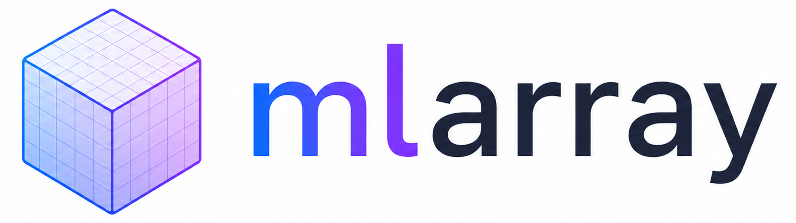

<p align="center">
  
</p>

<p align="center">
  <a href="https://pypi.org/project/mlarray/"></a>
  <a href="https://pypi.org/project/mlarray/"></a>
  <a href="https://github.com/MIC-DKFZ/mlarray/actions"></a>
  <a href="https://MIC-DKFZ.github.io/mlarray/"></a>
  <a href="https://github.com/MIC-DKFZ/mlarray/blob/main/LICENSE"></a>
</p>

**tl;dr:** Working with large medical or scientific images for machine learning? -> Use MLArray.

MLArray is a purpose-built file format for *N*-dimensional medical and scientific array data in machine learning workflows. It replaces the usual patchwork of source formats and late-stage conversions to NumPy/Zarr/Blosc2 by layering **standardized metadata** on top of a **Blosc2-backed** storage layout, so the same files work reliably across training, analysis, and visualization tools (including [napari](https://github.com/MIC-DKFZ/napari-mlarray) and [3D Slicer](https://github.com/MIC-DKFZ/SlicerMLArray)).

## Installation

You can install mlarray via [pip](https://pypi.org/project/mlarray/):
```bash
pip install mlarray
```

To enable the `mlarray_convert` CLI command (conversion with MedVol 1.0 or newer), install MLArray with the extra dependencies:
```bash
pip install mlarray[all]
```

## Documentaion

See the [documentation](https://MIC-DKFZ.github.io/mlarray/) for the [API reference](https://MIC-DKFZ.github.io/mlarray/api/), the [metadata schema](https://MIC-DKFZ.github.io/mlarray/schema/), [usage examples](https://MIC-DKFZ.github.io/mlarray/usage/) or [CLI usage](https://MIC-DKFZ.github.io/mlarray/cli/).

## Usage

Below are common usage patterns for loading, saving, and working with metadata.

### Default usage

```python
import numpy as np
from mlarray import MLArray

array = np.random.random((128, 256, 256))
image = MLArray(array)  # Create MLArray image
image.save("sample.mla")

image = MLArray("sample.mla")  # Loads image
```

### Memory-mapped usage

```python
from mlarray import MLArray
import numpy as np

# read-only, partial access (default)
image = MLArray.open("sample.mla", mmap_mode='r')  
crop = image[10:20, 50:60]  # Read crop

# read/write, partial access
image = MLArray.open("sample.mla", mmap_mode='r+')  
image[10:20, 50:60] *= 5  # Modify crop in memory and disk

# read/write, partial access, create/overwrite
array = np.random.random((128, 256, 256))
image = MLArray.create("sample.mla", shape=array.shape, dtype=array.dtype, mmap_mode='w+')
image[...] = array  # Modify image in memory and disk
```

### Fast reading

`MLArray.open` reads lazily: `image[...]` decompresses only the chunks a patch touches. The first open in a process also turns on blosc2's read-ahead (4 threads), which fetches those chunks in parallel and makes reads of data not in the page cache several times faster, especially on network storage. Change it with `mlarray.set_read_ahead(n)` (`0` turns it off) or the `BLOSC_PREFETCH` environment variable. Files are written with nnU-Net's layout and compression settings; see [ML Optimization](docs/optimization.md) for details.

### Metadata

Metadata is explicit and domain-neutral: what each axis is, where the array sits in physical space, what
its values mean, optional domain profiles, and your own metadata. Geometry is never implied: spacing,
origin and direction always refer to a declared space.

```python
import numpy as np
from mlarray import MLArray

array = np.random.random((64, 128, 128))
image = MLArray(
    array,
    axes=["z", "y", "x"],
    spacing=(1.5, 1.0, 1.0),          # per array axis, in array order
    origin=(10.0, 10.0, 30.0),        # centre of index (0, 0, 0)
    direction=[[0, 0, 1], [0, 1, 0], [1, 0, 0]],  # column c: unit vector of array axis c
    space="patient",                  # DICOM patient frame (LPS)
    values={"kind": "measurement", "unit": "hounsfield_unit"},
    user={"patient_id": "123"},       # any metadata of your own
)

print(image.spacing)         # (1.5, 1.0, 1.0)
print(image.letter_codes())  # ('S', 'P', 'L')
image.set_geometry(spacing=(1.5, 5.3, 1.0))
image.user["study_id"] = "study-001"
image.save("with-metadata.mla")

# Open memory-mapped
image = MLArray.open("with-metadata.mla", mmap_mode='r+')
image.user["study_id"] = "new-study"  # Modify metadata
image.close()  # Close and save metadata, only necessary to save modified metadata
```

Segmentations, ML profiles and derived images:

```python
import numpy as np
from mlarray import MLArray

base = MLArray("with-metadata.mla")
seg = MLArray(
    np.zeros(base.shape, dtype=np.uint8),
    copy=base,  # geometry, values, profiles and user metadata of base (never its source)
    values={"kind": "label", "labels": {"0": {"name": "background"}, "1": {"name": "liver"}}},
    profiles={"ml": {"split": "train"}},
)
seg.save("seg.mla")
```

See [Usage](docs/usage.md) and [Schema](docs/schema.md) for the full metadata model.

### Patch size variants

Default patch size (192):
```python
from mlarray import MLArray

image = MLArray("sample.mla")  # Existing file
image.save("default-patch.mla")  # Keeps existing layout metadata

loaded = MLArray("sample.mla")
image = MLArray(loaded.to_numpy(), patch_size='default')
image.save("default-patch-relayout.mla")  # Uses constructor patch_size='default' (192)
```

Custom isotropic patch size (512):
```python
from mlarray import MLArray

loaded = MLArray("sample.mla")
image = MLArray(loaded.to_numpy(), patch_size=512)
image.save("patch-512.mla")
```

Custom non-isotropic patch size:
```python
from mlarray import MLArray

loaded = MLArray("sample.mla")
image = MLArray(loaded.to_numpy(), patch_size=(128, 192, 256))
image.save("patch-non-iso.mla")
```

Manual chunk/block size:
```python
from mlarray import MLArray

loaded = MLArray("sample.mla")
image = MLArray(
    loaded.to_numpy(),
    patch_size=None,
    chunk_size=(1, 128, 128),
    block_size=(1, 32, 32),
)
image.save("manual-chunk-block.mla")
```

Let Blosc2 itself configure chunk/block size:
```python
from mlarray import MLArray

loaded = MLArray("sample.mla")
image = MLArray(loaded.to_numpy(), patch_size=None)
# If patch_size, chunk_size and block_size are all None, Blosc2 will auto-configure chunk and block size
image.save("blosc2-auto.mla")
```

## CLI

### mlarray_header

Print the metadata of a `.mla` file as JSON (`--source` and `--user` add the original metadata of
converted files and the user metadata).

```bash
mlarray_header sample.mla
```

### mlarray_convert

Convert between MLArray and NIfTI, NRRD, MetaImage, MGH/MGZ and DICOM with
[MedVol](https://github.com/MIC-DKFZ/MedVol) 1.0 or newer (`pip install "mlarray[all]"`). Nothing is reoriented, rescaled or
dropped silently: the array keeps its stored order and dtype, the geometry is taken from the file's own fields,
the original header is kept in `source` so the file can be written back faithfully, and every choice is reported.

```bash
mlarray_convert sample.nii.gz sample.mla
mlarray_convert sample.mla roundtrip.nii.gz
mlarray_convert dicom_dir/ ct.mla --dicom-tilt exact
mlarray_convert ct.mla out_dir/ --target-format dicom      # re-emits the original DICOM series
```

Ambiguities are resolved by explicit MedVol policies, e.g. `--nifti-form sform` when a NIfTI's qform and sform
disagree, or `--world-frame ras` to store the patient space in RAS instead of DICOM's LPS.

## Contributing

Contributions are welcome! Please open a pull request with clear changes and add tests when appropriate.

## Acknowledgments

<p align="left">
   &nbsp;&nbsp;&nbsp;&nbsp;
  
</p>

This repository is developed and maintained by the Applied Computer Vision Lab (ACVL)
of [Helmholtz Imaging](https://www.helmholtz-imaging.de/) and the
[Division of Medical Image Computing](https://www.dkfz.de/en/medical-image-computing) at DKFZ.
